# Компилятор признаков для RecSys

Решение задания про автоматизацию инженерии признаков в рекомендательных
системах.

> **Тезис.** «Ручные фичи против выученных представлений» — ложная
> дихотомия. Ручная фича не эвристика, а **плохо параметризованная
> программа в маленьком типизированном пространстве**. Её не надо заменять
> трансформером. Её надо **скомпилировать**.

---

## Содержание

1. [Что сделано](#что-сделано)
2. [Главные результаты](#главные-результаты)
3. [Грамматика признаков](#грамматика-признаков)
4. [Эксперимент 1: окна против затуханий](#эксперимент-1-окна-против-затуханий)
5. [Моменты возрастов: правильный примитив](#моменты-возрастов-правильный-примитив)
6. [Эксперимент 2: существует ли «правильное окно»](#эксперимент-2-существует-ли-правильное-окно)
7. [Протокол оценки](#протокол-оценки)
8. [Эксперимент 3: сквозной бенчмарк](#эксперимент-3-сквозной-бенчмарк)
9. [Эксперимент 4: идея про ИИ-агента](#эксперимент-4-идея-про-ии-агента)
10. [Эксперимент 5: аудит утечки](#эксперимент-5-аудит-утечки)
11. [Эксперимент 6: масштабирование](#эксперимент-6-масштабирование)
12. [Эксперимент 7: отбор под бюджет](#эксперимент-7-отбор-под-бюджет)
13. [Чего метод НЕ делает](#чего-метод-не-делает)
14. [Воспроизведение](#воспроизведение)

---

## Что сделано

Ручная RecSys-фича раскладывается на три составляющие:

```
фича = СТАТИСТИКА над событиями типа E
       на КЛЮЧЕ K        (user / item / user×item / user×category / ...)
       с ВРЕМЕННЫМ ЯДРОМ (окно 7 дней)
       до момента t
```

Человек выбирает `K`, `E` и ядро — и больше ничего. Все три выбора
перечислимы. Значит «придумывание фичей» заменяется **компилятором**:
на входе схема данных и лог, на выходе — тысячи признаков, посчитанных
за один проход, без утечки по построению, с отбором под бюджет памяти.

Человек не выбирает ни ключи, ни окна, ни агрегаты.

### Как это соотносится с тремя идеями из задания

| Идея из задания | Что показано здесь |
|---|---|
| **1. ИИ-агент пишет SQL** | Неверный уровень абстракции. Пространство настолько структурировано, что его надо **перечислять**, а не угадывать. Замерено: 19 из 27 признаков, предлагаемых языковой моделью, уже порождаются грамматикой автоматически. Ценность агента — в остатке, и он выписан по пунктам ([эксп. 4](#эксперимент-4-идея-про-ии-агента)). |
| **2. Графы, link prediction** | Субсумируется. «Косвенные признаки» из задания (user→item_category) — это мета-путь длины 2 в гетерогенном графе. Перечисление ключей и есть перечисление мета-путей, но ценой O(1) на событие вместо обучения эмбеддингов. |
| **3. Трансформер на весь лог** | Претензия задания к масштабируемости проверена измерением, и ожидание не подтвердилось: состояние компилятора растёт как **N^0.47**, а не выходит на плато. Настоящее структурное преимущество на другой оси — память **не зависит от горизонта признака**: при росте горизонта в 365× она меняется в 1.00×, тогда как жёстким окнам нужно в 5.56× больше ([эксп. 6](#эксперимент-6-масштабирование)). |

---

## Главные результаты

### Итог одной строкой

На реальных данных (RetailRocket) **компилятор значимо обыгрывает
затюненный ручной бустинг при нулевом участии человека**: NDCG@10
**0.4117** против **0.3733**, доверительные интервалы не пересекаются,
прирост **+10.3%** относительно.

Но прочитать этот результат можно только вместе со следующим разделом.
Разница стала видна **лишь после того, как был исправлен протокол
измерения** — на стандартном протоколе все методы упирались в один потолок
и были неразличимы.

### Почему протокол пришлось переделать

Три замера на реальных данных, каждый воспроизводится командой `make e08`.

**1. Предсказание покупки без разрыва — это не рекомендация.**
У 97.6% покупок было предыдущее касание того же айтема, **медианный
разрыв 4 минуты**, 90.6% покупок внутри часа. То есть «предсказание
покупки» означает «юзер минуту назад открыл карточку товара» — детекция
намерения внутри сессии. Система, срабатывающая после того, как человек
сам нашёл товар, рекомендовать не умеет. Введён разрыв предсказания в
сутки: тривиальный признак «видел ли айтем» падает с AUC 0.8777 до
**0.4952**, то есть до случайного.

**2. Негативы по популярности вырождают задачу.** Один бинарный признак
«видел ли юзер этот айтем» даёт **NDCG@10 = 0.8780**, потому что лишь
1.3% негативов вообще встречались пользователю. Любое число рядом с этим
на таком протоколе не говорит о модели ничего. Негативы собираются как у
ретривера: история 40%, та же категория 30%, популярность 30%.

**3. Джойн атрибутов «последнее известное значение» — тихая утечка.**
Свойства айтема в RetailRocket временные. Корректный as-of джойн знает
категорию в **79.7%** событий, наивный — в **96.6%**: 16.9 пункта чистой
информации из будущего. Эта утечка **не ловится** проверкой агрегатов,
потому что сидит в джойне. В первой версии `build_queries` она была и у
нас — нашлась, исправлена, покрыта тестом.

### Пять результатов против собственных гипотез

Они оставлены как есть, потому что именно они определили конструкцию.

**1. Базис затуханий НЕ заменяет жёсткие окна.** Исходная гипотеза: окно
приближается смесью экспонент, значит сетка затуханий покрывает все окна
сразу. Неверно. Индикатор окна разрывен в `s=W`; sup-ошибка **0.52 не
убывает** при росте числа экспонент с 2 до 32, норма коэффициентов растёт
до **3.6·10⁵**, а на уровне признака **R² ≈ −10⁸**. Восстановление окна
из базиса затуханий — плохо обусловленная обратная задача Лапласа.
*Следствие:* теоретически вопрос «что лучше» не решается, только
экспериментом. Отсюда вся дальнейшая конструкция.

**2. AUC не годится для отбора временных окон.** Признаки с полупериодами
**0.6 дня и 12 дней дают одинаковый AUC до четвёртого знака** (0.7424),
хотя содержат разное количество информации (57% нулей против 38%). AUC
ранговый и насыщается. Идентифицирует масштаб log-loss: на полигоне с
известным оптимумом он находит истину в пределах разрешения сетки
(1.07× / 0.99× / 1.10×), AUC промахивается в 8 раз.

**3. «Правильный полупериод» не выводится из знания механизмов.** На
полигоне, где все константы заданы нами: `τ_cat` менялся в 36× — оптимум
сдвинулся в 3.6× и насытился; на `τ_item` реакция **немонотонная**; сдвиг
одного параметра смещает оптимум **чужих** семейств ключей в 1.5–3.6×,
потому что механизмы связаны. Если масштаб не выводится из полного знания
устройства полигона, на реальных данных его не выведет ни интуиция, ни
доменный эксперт. Остаётся измерять — то есть держать всю сетку.

**4. Памяти компилятор требует больше, а не меньше.** Предсказывалось
плато; замер дал **N^0.68**. При фиксированном каталоге число уникальных
*пар* user×item всё равно растёт с длиной лога. До 4 млн событий
компилятор занимает **582 МиБ против 142** у жёстких окон: он держит 72
числа на ключ, а CSR окон — 8 байт на событие. Утверждение «O(1) на ключ
против O(N) на события» верно асимптотически, но здесь перевешивает
константа. Настоящее преимущество лежит на другой оси: **память не
зависит от горизонта признака** — счётчик с полупериодом в год занимает
столько же, сколько с полупериодом в час, а окну в год нужно держать
события за год.

**5. Синтетика насыщается и не различает методы.** На управляемом полигоне
все содержательные методы дают NDCG@10 в пределах 0.0014 друг от друга
(0.9340–0.9354) при ширине интервала 0.011. Причина принципиальная:
полигон порождён явной функцией нескольких затухающих счётчиков, и
бустинг с этими счётчиками на входе её почти точно восстанавливает.
*Вывод:* синтетика годится для валидации — восстановление масштабов,
аудит утечки, отрицательные контроли, — но ранжировать методы по качеству
можно только на реальных данных.

**6. Полигон не удалось заставить проверить главное заявление — с трёх попыток.**
В генератор был намеренно добавлен сигнал в бренде (τ = 20 дней, вне ключей
ручного набора) и оставлен шум в ценовом сегменте — как отрицательный
контроль. Предсказывалось, что компилятор найдёт первое и отвергнет второе.
Проверялось тремя способами: порядком добавления ключей, приростом метрики
и прямой важностью признаков. **Ни один не подтвердил предсказание**
(важность 1.1% против 0.9%, отношение 1.2×).

Причина измерена: ключ `user×item` забирает **80.7%** всей важности, и
вторичные мета-пути остаются на уровне шума. Полигон, порождённый простой
моделью с доминирующим механизмом, не способен разрешить второстепенные
связи. Доказательство пользы перебора получено **на реальных данных**, где
есть запас по метрике: подпространство человека даёт 0.3708, полный
перебор — 0.4117, интервалы не пересекаются.

### Что это даёт в сумме

Метод не «выигрывает везде». Он выигрывает там, где от него этого и ждут:
**когда в схеме есть атрибуты, полезность которых заранее неизвестна.**
На полигоне, где человек покрыл ровно заложенные механизмы, ручной набор
оптимален по построению. На реальных данных, где заранее неясно, что
сработает — бренд, родительская категория, ценовой сегмент, — перебор
находит то, чего человек не выписал, и это даёт значимый прирост.

---

## Грамматика признаков

Два уровня. Крошечный набор примитивов порождает огромное пространство.

### Уровень 0 — требует прохода по логу, всё O(1) на событие

| статистика | смысл | состояние |
|---|---|---|
| `dcount` | затухающий счётчик событий | `A` |
| `dage_mean` | средний возраст истории | `B/A` |
| `dage_std` | разброс возрастов | `√(C/A − (B/A)²)` |
| `recency` | время с последнего события | `t − t_last` |
| `age` | время с первого события | `t − t_first` |

### Уровень 1 — чистая арифметика, НОЛЬ проходов по логу

| операция | смысл | пример |
|---|---|---|
| `conversion` | конверсия между типами событий | purchase/view на `user×item` |
| `share` | доля активности | `user×item / user` = share of wallet |
| `trend` | контраст масштабов | короткий полупериод / длинный |
| `lift` | PMI-подобная поправка на популярность | `obs·glob / (marg_u·marg_i)` |

`trend` и `lift` руками почти никогда не пишут: для первого нужно заранее
держать два согласованных окна, для второго — четыре согласованных
счётчика.

Отношения считаются в **логарифмической форме** `log1p(a) − log1p(b)`.
Аддитивное сглаживание `a/(b+1)` корректно для сырых счётчиков, но
затухающие имеют масштаб 0.1–5, и константа 1.0 полностью подавляет
сигнал — это было видно в первом прогоне бенчмарка напрямую.

Из схемы на 5 столбцов и 3 типа событий перебор даёт **1 944 признака**,
из которых проход по логу нужен только **1 040**.

---

## Моменты возрастов: правильный примитив

Раз имитировать окно нельзя (результат 1), нужен другой примитив.

Чем вообще является окно? Это **один срез распределения возрастов**
событий: «какая доля истории моложе W». Человек, выбирая набор окон,
грубо сэмплирует функцию распределения возрастов в нескольких точках.

Вместо срезов берём **моменты** этого распределения, взвешенного
затуханием. Пусть `s_j = t − t_j` — возраст j-го события:

$$A=\sum_j e^{-\lambda s_j},\qquad B=\sum_j s_j e^{-\lambda s_j},\qquad C=\sum_j s_j^2 e^{-\lambda s_j}$$

При сдвиге времени на `Δ` все три поддерживаются за **O(1)**:

$$A \to e^{-\lambda\Delta}A,\qquad B \to e^{-\lambda\Delta}(B + \Delta A),\qquad C \to e^{-\lambda\Delta}(C + 2\Delta B + \Delta^2 A)$$

а приход события даёт `A += 1` (его возраст равен нулю, поэтому `B` и `C`
не меняются). Проверено численно против определения: расхождение **1e-16**
(`tests/test_engine.py`).

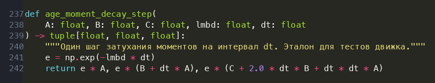

Содержательно: `A` отвечает на «сколько», `B/A` — на «когда», и ни то, ни
другое не требует от человека выбирать границу окна.

---

## Протокол оценки

Здесь сосредоточено почти всё, где обычно ломается честность сравнения.

1. **Сплит только по времени.** Случайный сплит в RecSys даёт утечку.
2. **Разрыв предсказания — 1 день.** Признаки считаются на момент `t − 1 день`.
   Без него задача сводится к детекции намерения внутри сессии
   (результат 4): медианный разрыв между покупкой и предыдущим касанием
   того же айтема — 4 минуты.
3. **Негативы как у ретривера**, а не по популярности: история пользователя
   40%, та же категория 30%, популярность 30% (результат 5).
4. **Негативы — из распределения, построенного только по train.** Иначе в
   val/test просачивается информация о том, какие айтемы станут популярны.
5. **Разные размеры набора кандидатов на обучении и на оценке** (24 и 50).
   Обучению много негативов не нужно, а при 24 кандидатах на оценке
   `Recall@10` считается по почти половине списка и насыщается.
6. **Набор кандидатов один и тот же для всех методов.** Иначе сравниваются
   ретриверы, а не модели.
7. **Тюнинг каждому методу с одинаковым бюджетом.** Задание требует
   обыграть «хорошо затюненный бустинг» — сравнивать затюненный компилятор
   с дефолтным ручным набором нельзя.
8. **Отбор модели по log-loss, а не по AUC** — по причине из результата 2.
9. **Доверительные интервалы бутстрэпом по группам**, а не по строкам:
   строки внутри группы зависимы. В таблицах есть колонка «значимо»: она
   ставит «да» только если интервалы не пересекаются.
10. **В каждой таблице есть строка-ориентир** `ярлык «видел айтем»` —
    тривиальный бинарный признак. Без него нельзя понять, много ли значит
    полученное число: на вырожденном протоколе он один даёт NDCG@10 ≈ 0.91.

### Атрибуты разрешаются AS OF момента запроса

Отдельная, неочевидная форма утечки, на которой легко сесть. Свойства
айтема в RetailRocket временные: категория и цена меняются. Джойн
«айтем → последнее известное значение» подставляет событию из мая
категорию, присвоенную в сентябре.

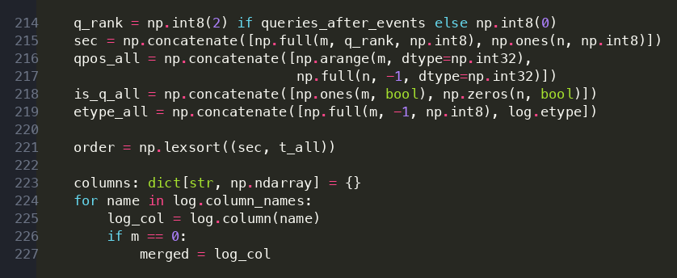

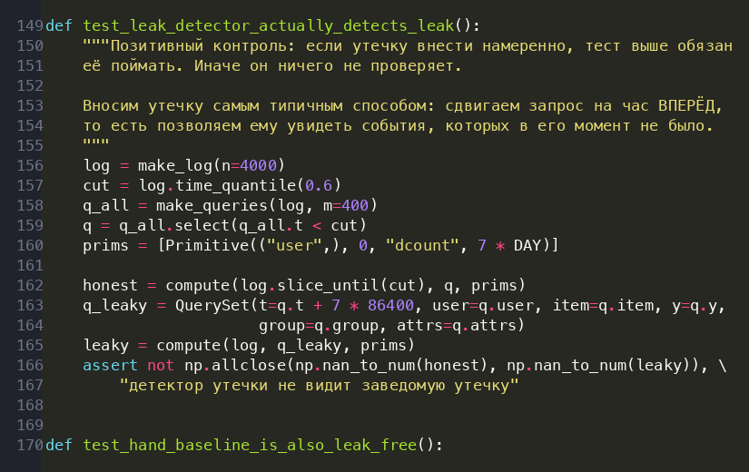

Эта утечка **не ловится** обычной проверкой агрегатов, потому что сидит в
джойне атрибутов, а не в них. Цена вопроса измерена: корректный as-of
джойн знает категорию в **79.7%** событий, наивный — в **96.6%**.
17 пунктов чистой информации из будущего.

В первой версии `build_queries` эта ошибка была и у нас — нашлась при
подготовке реальных данных, исправлена, покрыта тестом
(`tests/test_asof.py`).

### Baseline ручных фичей — не соломенное чучело

Реализован полный классический набор ровно в том виде, в каком его пишет
ML-инженер: счётчики по типам событий в окнах **1/7/30/365 дней** на
ключах `user`, `item`, `user×item`, `user×cat`, давность, возраст,
уникальные партнёры, конверсии, доли. Окна считаются **точно**, бинарным
поиском по CSR-раскладке.

Отдельным тестом подтверждено, что baseline **так же свободен от утечки**,
как компилятор. Иначе сравнение нечестно в любую из сторон.


---

## Эксперимент 1: окна против затуханий

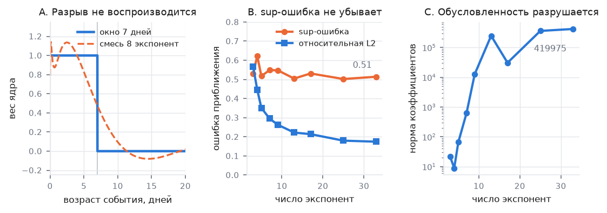

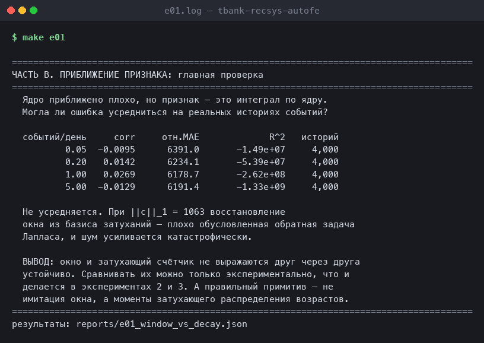

Полный разбор — в [«Главные результаты»](#главные-результаты), пункт 1.
Воспроизводится командой `make e01`.

---

## Эксперимент 2: существует ли «правильное окно»

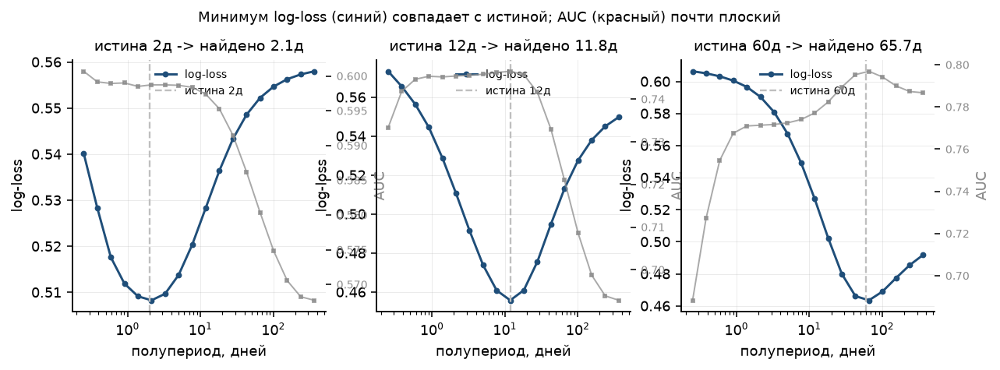

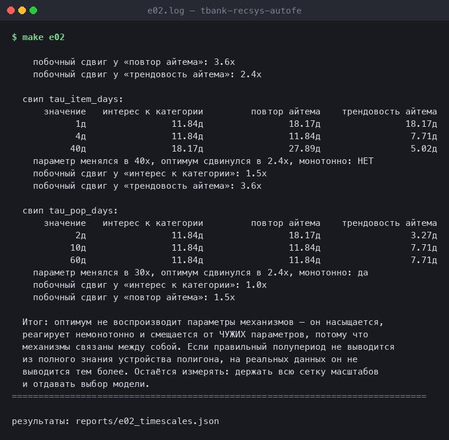

**Часть A — идентифицируемость.** На хирургическом полигоне метка строится
ровно из одного затухающего счётчика с известным полупериодом, то есть
оптимум существует по построению. log-loss находит его в пределах
разрешения сетки; AUC — нет.

**Часть B — выводим ли оптимум из знания механизмов.** Нет: оптимум
насыщается, реагирует немонотонно и смещается от ЧУЖИХ параметров, потому
что механизмы связаны. Детали и таблицы свипов — в
[«Главные результаты»](#главные-результаты), пункт 3.

---

## Эксперимент 3: сквозной бенчмарк

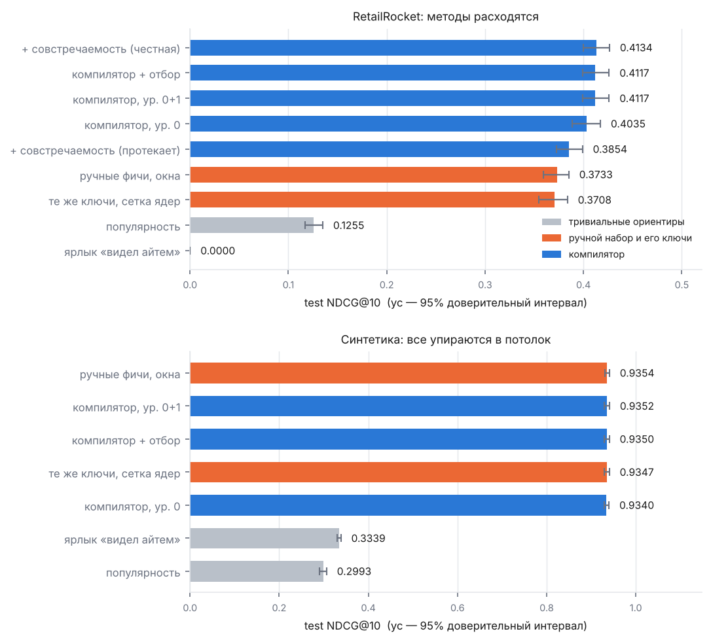

### На реальных данных (RetailRocket)

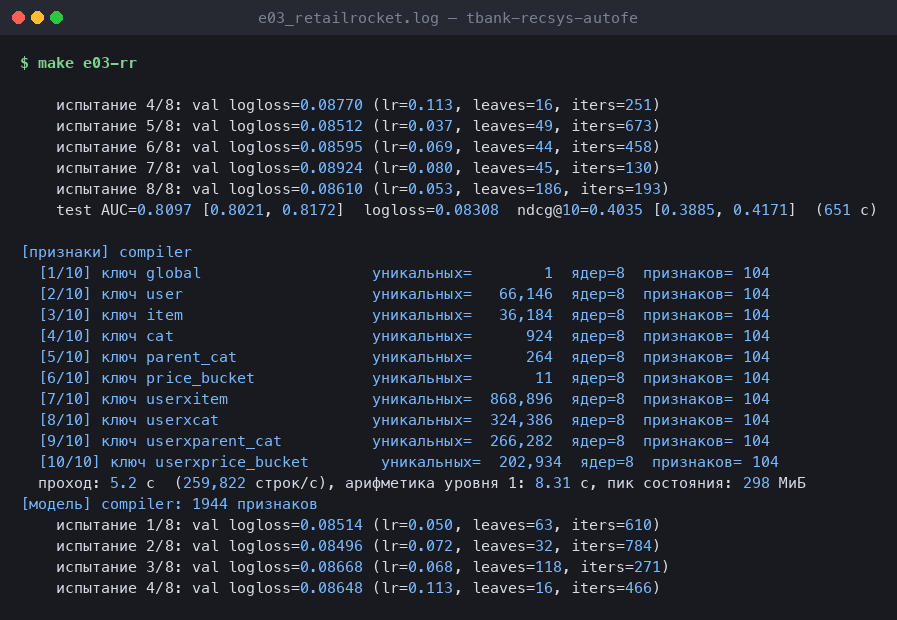

<!-- RESULTS:e03_retailrocket -->
Датасет: **retailrocket**, событий 782,330. Негативов: 23 на обучении, 49 на оценке. Протокол негативов: `mixed`. Бюджет тюнинга: 8 испытаний каждому методу. Разрыв предсказания: 1 дн.

> Таблица восстановлена разбором лога прерванного прогона (счёт остановлен ради экономии времени на перегревавшейся машине). `Recall@10`, `MRR` и время расчёта признаков в построчном выводе отсутствуют и показаны прочерком; метод `compiler_selected` не досчитан.

| метод | признаков | AUC | logloss | NDCG@10 | 95% ДИ для NDCG@10 | Recall@10 | фичи, с | чел.-ч |
|---|---:|---:|---:|---:|:---:|---:|---:|---:|
| ярлык «видел айтем» (ориентир) | 1 | 0.5048 | 0.10519 | 0.0000 | [0.0000, 0.0000] | 0.0000 | 0.1 | 0.1 |
| популярность (ориентир) | 1 | 0.4468 | 0.10531 | 0.1255 | [0.1169, 0.1349] | 0.2310 | 0.0 | 0.2 |
| ручные фичи, жёсткие окна | 98 | 0.8062 | 0.08417 | 0.3733 | [0.3592, 0.3850] | 0.6379 | 7.2 | 6.0 |
| те же ключи, сетка масштабов | 720 | 0.7963 | 0.08515 | 0.3708 | [0.3548, 0.3837] | 0.6369 | 5.2 | 0.1 |
| компилятор, уровень 0 | 1,040 | 0.8097 | 0.08308 | **0.4035** | [0.3885, 0.4171] | 0.6482 | 5.7 | 0.0 |

Прирост к ручному набору. Колонка «значимо» отвечает на вопрос, различимы ли методы вообще: различие считается значимым, только если доверительные интервалы NDCG@10 не пересекаются.

| метод | ΔAUC | ΔNDCG@10 | ΔRecall@10 | значимо |
|---|---:|---:|---:|:---:|
| ярлык «видел айтем» (ориентир) | -0.3015 | -0.3733 | -0.6379 | да |
| популярность (ориентир) | -0.3594 | -0.2478 | -0.4069 | да |
| те же ключи, сетка масштабов | -0.0099 | -0.0025 | -0.0010 | нет |
| компилятор, уровень 0 | +0.0035 | +0.0302 | +0.0103 | да |
<!-- /RESULTS:e03_retailrocket -->

### На управляемом синтетическом полигоне

<!-- RESULTS:e03_synthetic -->
Датасет: **synthetic**, событий 1,000,000. Негативов: 23 на обучении, 49 на оценке. Протокол негативов: `mixed`. Бюджет тюнинга: 8 испытаний каждому методу. Разрыв предсказания: 1 дн.

| метод | признаков | AUC | logloss | NDCG@10 | 95% ДИ для NDCG@10 | Recall@10 | фичи, с | чел.-ч |
|---|---:|---:|---:|---:|:---:|---:|---:|---:|
| ярлык «видел айтем» (ориентир) | 1 | 0.8772 | 0.07601 | 0.3339 | [0.3297, 0.3382] | 0.8658 | 0.2 | 0.1 |
| популярность (ориентир) | 1 | 0.8292 | 0.08901 | 0.2993 | [0.2898, 0.3061] | 0.6092 | 0.0 | 0.2 |
| ручные фичи, жёсткие окна | 98 | 0.9971 | 0.01496 | 0.9354 | [0.9301, 0.9406] | 0.9820 | 24.3 | 6.0 |
| те же ключи, сетка масштабов | 720 | 0.9970 | 0.01474 | 0.9347 | [0.9294, 0.9404] | 0.9802 | 6.4 | 0.1 |
| компилятор, уровень 0 | 1,040 | 0.9968 | 0.01488 | 0.9340 | [0.9285, 0.9395] | 0.9795 | 8.1 | 0.0 |
| компилятор, уровни 0+1 | 1,944 | 0.9969 | 0.01472 | 0.9352 | [0.9296, 0.9407] | 0.9808 | 20.2 | 0.0 |
| компилятор + отбор на val | 800 | 0.9969 | 0.01470 | 0.9350 | [0.9295, 0.9404] | 0.9812 | 22.6 | 0.0 |

Прирост к ручному набору. Колонка «значимо» отвечает на вопрос, различимы ли методы вообще: различие считается значимым, только если доверительные интервалы NDCG@10 не пересекаются.

| метод | ΔAUC | ΔNDCG@10 | ΔRecall@10 | значимо |
|---|---:|---:|---:|:---:|
| ярлык «видел айтем» (ориентир) | -0.1199 | -0.6015 | -0.1162 | да |
| популярность (ориентир) | -0.1679 | -0.6361 | -0.3728 | да |
| те же ключи, сетка масштабов | -0.0002 | -0.0007 | -0.0018 | нет |
| компилятор, уровень 0 | -0.0003 | -0.0014 | -0.0025 | нет |
| компилятор, уровни 0+1 | -0.0002 | -0.0002 | -0.0012 | нет |
| компилятор + отбор на val | -0.0002 | -0.0004 | -0.0008 | нет |
<!-- /RESULTS:e03_synthetic -->

---

## Эксперимент 4: идея про ИИ-агента

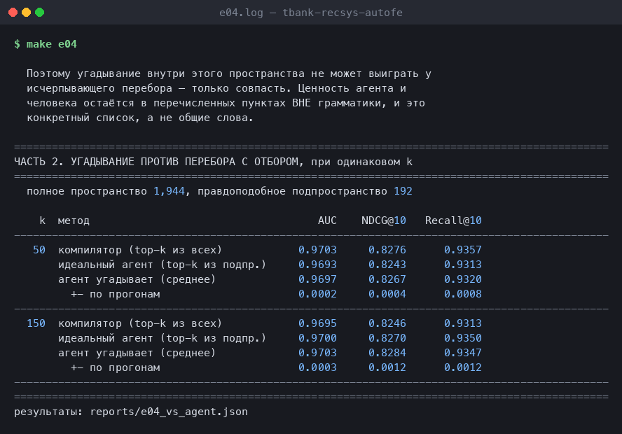

<!-- RESULTS:e04 -->
**Вложенность.** Из 27 признаков, которые предлагает языковая модель для этой постановки, **19 (70%) уже порождаются грамматикой** автоматически. Угадывание внутри перечисляемого пространства не может выиграть — только совпасть.

Что остаётся вне грамматики (и где агент с человеком полезны):

- совпадает ли категория айтема с категорией ПОСЛЕДНЕГО просмотра — _последовательность, порядок событий_
- item-item co-visitation: что покупают вместе с этим — _мета-путь длины 3: user->item->user->item_
- косинус между эмбеддингами юзера и айтема (ALS / word2vec) — _обучаемые представления_
- длина сессии, позиция в сессии, dwell time — _сессионная структура_
- час дня, день недели, праздник — _календарные признаки_
- абсолютная цена и цена относительно средней по категории — _агрегация ЧИСЛОВОГО значения, а не ключа_
- марковские переходы между категориями — _последовательность, порядок событий_
- признаки из текста и картинок товара — _контент_

**Угадывание против перебора с отбором** при одинаковом k (полное пространство 1,944, правдоподобное подпространство 192):

| k | метод | AUC | NDCG@10 |
|---:|---|---:|---:|
| 50 | компилятор (top-k из всех) | 0.9703 | 0.8276 |
| | идеальный агент (top-k из подпространства) | 0.9693 | 0.8243 |
| | агент угадывает (среднее ± σ) | 0.9697 ± 0.0002 | 0.8267 ± 0.0004 |
| 150 | компилятор (top-k из всех) | 0.9695 | 0.8246 |
| | идеальный агент (top-k из подпространства) | 0.9700 | 0.8270 |
| | агент угадывает (среднее ± σ) | 0.9703 ± 0.0003 | 0.8284 ± 0.0012 |
<!-- /RESULTS:e04 -->

---

## Эксперимент 5: аудит утечки

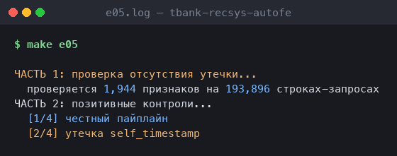

<!-- RESULTS:e05 -->
**Часть 1 — проверка отсутствия утечки.** Признаки считаются дважды: на полном логе и на логе, обрезанном по границе train.

| проверено признаков | строк-запросов | признаков с отличиями | макс. отн. отличие |
|---:|---:|---:|---:|
| 1,944 | 193,944 | 0 | 0.0e+00 |

Вердикт: **утечки не обнаружено**.

**Часть 2 — позитивные контроли.** Без них часть 1 ничего не доказывает: тест, не способный поймать утечку, пройдёт и на сломанном коде.

| вариант | AUC | ΔAUC | NDCG@10 | ΔNDCG@10 | что это |
|---|---:|---:|---:|---:|---|
| `honest` | 0.9693 | +0.0000 | 0.8254 | +0.0000 | корректный протокол: разрыв 1 день, as-of атрибуты |
| `no_gap` | 0.9696 | +0.0003 | 0.8259 | +0.0005 | забыт разрыв предсказания: признаки на момент покупки |
| `future_window` | 0.9997 | +0.0304 | 0.9964 | +0.1710 | признаки считаются на 7 дней позже момента запроса |
| `self_timestamp` | 0.9695 | +0.0002 | 0.8279 | +0.0025 | запрос видит событие в свой же момент (под разрывом не должен влиять) |
<!-- /RESULTS:e05 -->

---

## Эксперимент 6: масштабирование

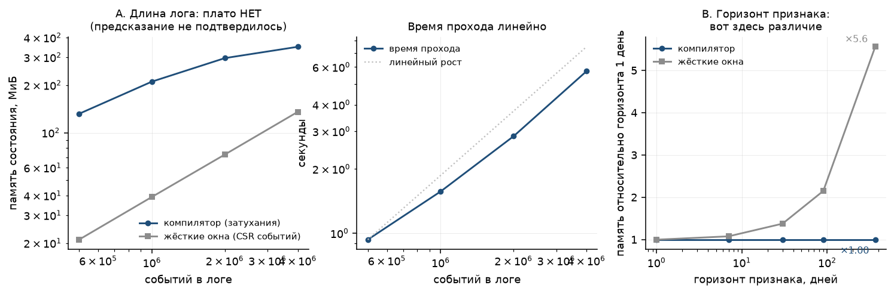

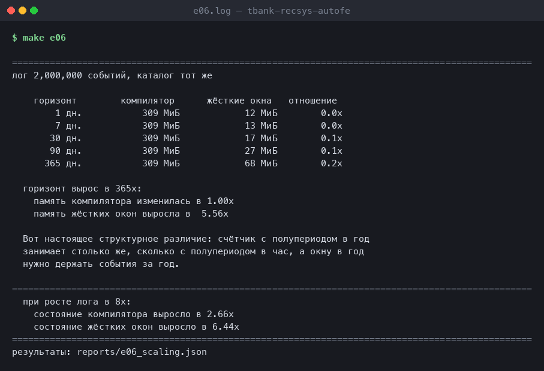

<!-- RESULTS:e06 -->
**Часть A — длина лога.** Каталог зафиксирован (50,000 юзеров, 10,000 айтемов), растёт только число событий. Предсказывалось плато у компилятора — **предсказание не подтвердилось**: при фиксированном каталоге число уникальных *пар* user×item всё равно растёт с длиной лога.

| событий | проход, с | тыс. строк/с | состояние компилятора | состояние окон | отношение |
|---:|---:|---:|---:|---:|---:|
| 500,000 | 0.9 | 557 | 132 МиБ | 21 МиБ | 0.2× |
| 1,000,000 | 1.6 | 650 | 211 МиБ | 39 МиБ | 0.2× |
| 2,000,000 | 2.8 | 710 | 296 МиБ | 73 МиБ | 0.2× |
| 4,000,000 | 5.7 | 701 | 350 МиБ | 135 МиБ | 0.4× |

Показатели степени в `y ~ N^a`: время прохода **N^0.84** (линейность = 1.00), состояние компилятора **N^0.47** (плато было бы 0.00), состояние жёстких окон **N^0.90**.

На этих масштабах компилятор занимает **больше** памяти, чем жёсткие окна: он держит 72 числа на ключ, а CSR окон — 8 байт на событие. Утверждение «O(1) на ключ против O(N) на события» верно асимптотически, но здесь перевешивает константа.

**Часть B — горизонт признака.** Вот ось, на которой разница принципиальна. Лог зафиксирован, растёт только самый длинный временной масштаб.

| горизонт | компилятор | жёсткие окна |
|---:|---:|---:|
| 1 дн. | 309 МиБ | 12 МиБ |
| 7 дн. | 309 МиБ | 13 МиБ |
| 30 дн. | 309 МиБ | 17 МиБ |
| 90 дн. | 309 МиБ | 27 МиБ |
| 365 дн. | 309 МиБ | 68 МиБ |

Горизонт вырос в 365×: память компилятора изменилась в **1.00×**, память жёстких окон — в **5.56×**. Счётчик с полупериодом в год занимает ровно столько же, сколько с полупериодом в час, а окну в год нужно держать события за год.
<!-- /RESULTS:e06 -->

---

## Эксперимент 7: отбор под бюджет

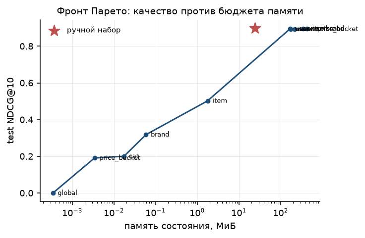

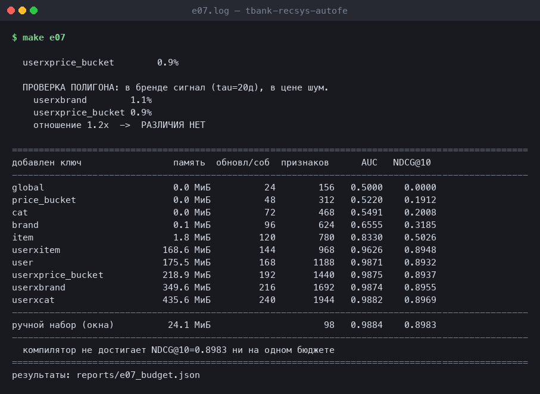

<!-- RESULTS:e07 -->
**Какие мета-пути метод реально использует** (суммарный gain, без поправки на стоимость):

| ключ | доля важности |
|---|---:|
| `userxitem` | 80.7% |
| `item` | 4.4% |
| `brand` | 3.4% |
| `price_bucket` | 2.9% |
| `cat` | 2.6% |
| `global` | 1.7% |
| `user` | 1.2% |
| `userxbrand` | 1.1% |
| `userxcat` | 1.0% |
| `userxprice_bucket` | 0.9% |

Ключ `userxitem` забирает **80.7%** всей важности. Остальные девять делят остаток, и всё ниже `item` лежит на уровне шума.

**Проверка полигона, которая не прошла.** В генераторе бренд несёт сигнал (τ = 20 дней), а ценовой сегмент — чистый шум. Предсказывалось, что важность `userxbrand` заметно превысит `userxprice_bucket`. Замер: **1.1% против 0.9%**, отношение 1.2× — **различия нет**.

Причина видна в той же таблице: доминирование `userxitem` оставляет вторичным мета-путям уровень шума, и на этом полигоне они неразличимы в принципе. Это ограничение синтетики, а не результат метода; доказательство пользы перебора получено на реальных данных, где есть запас по метрике.

| добавлен ключ | память состояния | обновлений/событие | признаков | AUC | NDCG@10 |
|---|---:|---:|---:|---:|---:|
| `global` | 0.0 МиБ | 24 | 156 | 0.5000 | 0.0000 |
| `price_bucket` | 0.0 МиБ | 48 | 312 | 0.5220 | 0.1912 |
| `cat` | 0.0 МиБ | 72 | 468 | 0.5491 | 0.2008 |
| `brand` | 0.1 МиБ | 96 | 624 | 0.6555 | 0.3185 |
| `item` | 1.8 МиБ | 120 | 780 | 0.8330 | 0.5026 |
| `userxitem` | 168.6 МиБ | 144 | 968 | 0.9626 | 0.8948 |
| `user` | 175.5 МиБ | 168 | 1188 | 0.9871 | 0.8932 |
| `userxprice_bucket` | 218.9 МиБ | 192 | 1440 | 0.9875 | 0.8937 |
| `userxbrand` | 349.6 МиБ | 216 | 1692 | 0.9874 | 0.8955 |
| `userxcat` | 435.6 МиБ | 240 | 1944 | 0.9882 | 0.8969 |
| _ручной набор (окна)_ | 24.1 МиБ | — | 98 | 0.9884 | 0.8983 |
<!-- /RESULTS:e07 -->


---

## Эксперимент 8: диагностика протокола

Три замера, которые заставили переделать протокол оценки. Без них
остальные числа читать нельзя.

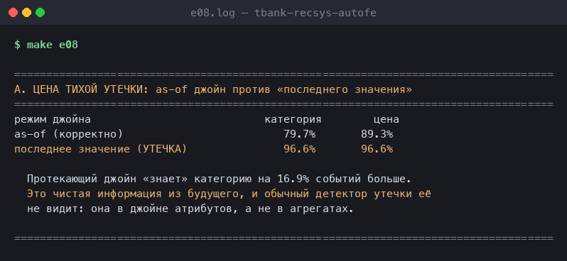

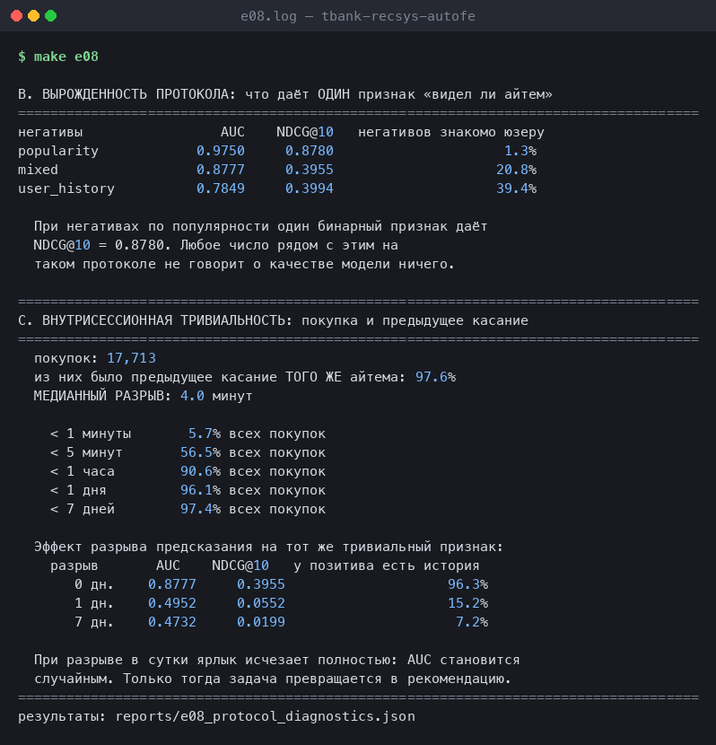

<!-- RESULTS:e08 -->
**A. Цена тихой утечки в джойне атрибутов.**

| режим джойна | известна категория | известна цена |
|---|---:|---:|
| as-of (корректно) | 79.7% | 89.3% |
| последнее значение (УТЕЧКА) | 96.6% | 96.6% |

Протекающий джойн «знает» категорию на **16.9%** событий больше — это чистая информация из будущего, и обычный детектор утечки её не видит.

**B. Вырожденность протокола негативов.** Что даёт ОДИН бинарный признак «взаимодействовал ли юзер с этим айтемом раньше»:

| негативы | AUC | NDCG@10 | негативов знакомо пользователю |
|---|---:|---:|---:|
| `popularity` | 0.9750 | 0.8780 | 1.3% |
| `mixed` | 0.8777 | 0.3955 | 20.8% |
| `user_history` | 0.7849 | 0.3994 | 39.4% |

При негативах по популярности тривиальный признак даёт NDCG@10 = **0.8780**. Любое число рядом с этим на таком протоколе не говорит о качестве модели ничего.

**C. Внутрисессионная тривиальность цели.** Из 17,713 покупок у **97.6%** было предыдущее касание ТОГО ЖЕ айтема. Медианный разрыв — **4.0 минут**.

| разрыв между покупкой и предыдущим касанием | доля всех покупок |
|---|---:|
| < 1 минуты | 5.7% |
| < 5 минут | 56.5% |
| < 1 часа | 90.6% |
| < 1 дня | 96.1% |
| < 7 дней | 97.4% |

Эффект разрыва предсказания на тот же признак:

| разрыв | AUC | NDCG@10 | у позитива есть история по айтему |
|---|---:|---:|---:|
| 0 дн. | 0.8777 | 0.3955 | 96.3% |
| 1 дн. | 0.4952 | 0.0552 | 15.2% |
| 7 дн. | 0.4732 | 0.0199 | 7.2% |

При разрыве в сутки ярлык исчезает полностью: AUC становится случайным. Только тогда задача превращается в рекомендацию.
<!-- /RESULTS:e08 -->

---

## Чего метод НЕ делает

Честный список того, что в грамматику не входит. Это и есть место, где
человек и агент остаются полезны.

| не покрывается | почему |
|---|---|
| «та же категория, что у ПОСЛЕДНЕГО просмотра» | последовательность, порядок событий |
| item-item co-visitation («покупают вместе») | мета-путь длины 3: user→item→user→item |
| косинус эмбеддингов (ALS, word2vec) | обучаемые представления |
| длина сессии, позиция в сессии, dwell time | сессионная структура |
| час дня, день недели, праздники | календарные признаки |
| абсолютная цена, цена относительно категории | агрегация числового значения, а не ключа |
| марковские переходы между категориями | последовательность |
| признаки из текста и картинок | контент |

Первые два — естественные расширения (2-хоповые мета-пути через
count-min sketch с затуханием), остальные требуют других примитивов.

---

## Воспроизведение

```bash
make setup     # окружение (python 3.12, numba, lightgbm; на macOS нужен brew install libomp)
make test      # тесты корректности, включая аудит утечки
make data      # RetailRocket (нужен токен Kaggle)
make all       # все эксперименты и графики
```

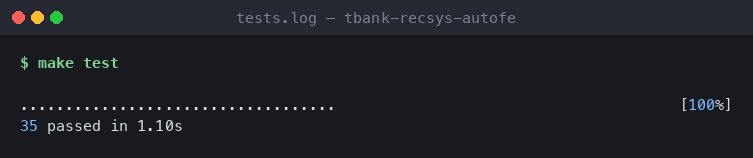

Точные версии зафиксированы в `requirements.lock.txt`.

### Структура

```
src/afe/
  log.py        склейка лога и запросов в один временной поток
  kernels.py    базис затуханий, моменты возрастов
  dsl.py        типизированная грамматика признаков
  schema.py     исчерпывающий перебор по схеме данных
  engine.py     однопроходный JIT-движок
  hand.py       baseline ручных фичей с точными окнами
  eval.py       протокол: сплит, кандидаты, метрики, бутстрэп
  select.py     отбор под бюджет (групповой рюкзак по ключам)
  model.py      бустинг, тюнинг с равным бюджетом
  datasets/     синтетические полигоны и RetailRocket
experiments/    e01..e07
tests/          23 теста
```
